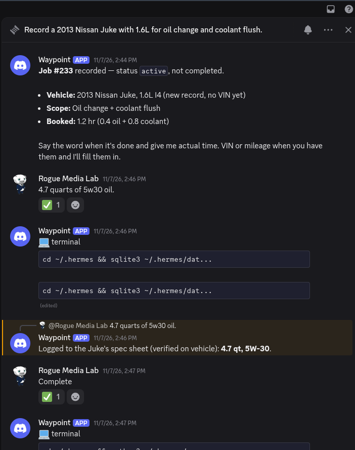
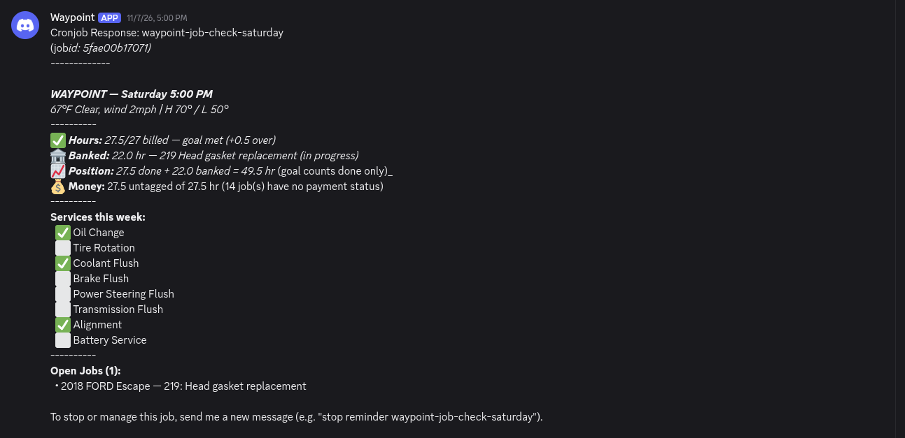

# Waypoint

[](#license)
[](https://www.python.org/downloads/)
[](https://www.sqlite.org/)
[](https://discord.com/)
[](#architecture)
[](#about)

> **Hands-free, sub-second shop-floor service tracking for independent auto techs.**
> SQLite-backed CLI. Voice-friendly via Discord. No cloud, no LLM, no API keys, no subscriptions.

[What it does](#what-it-does) · [Quick start](#quick-start) · [CLI reference](#cli-reference) · [Schema](#database-schema) · [Cron watchdog](#automated-job-check-cron) · [Pitfalls](#critical-pitfalls) · [License](#license) · **[For AI agents: AGENTS.md](./AGENTS.md)**

## See it in action

```
$ @Waypoint record 2019 Subaru Outback, oil change
✓ 2019 Subaru Outback — new vehicle created (id 16)
✓ Job DEMO-0021 opened: Oil change

$ @Waypoint complete job DEMO-0021 0.4
✓ Logged 24 minutes. Job complete. Miles: 86,000.

$ @Waypoint What is the labor to replace the control arms on a Ford Escape 2018
✓ Control Arm R&R (Suspension) — 3.0 hrs (Ford Escape 2013–2019)
```



A job from a plain message: the bot opens a thread per vehicle, books the labor
before I start, takes the oil spec when I read it off the hood, and closes the job
when I say it is done. No forms.

## Jobs Report

Two views of the same data: the list you pull when you want to check something,
and the nudge that shows up on its own.

```bash
$ python3 scripts/vehicle_db.py recent-jobs
[
  {
    "id": 246,
    "job_number": "226",
    "description": "Front brakes",
    "status": "complete",
    "year": 2018,
    "make": "NISSAN",
    "model": "Altima"
  },
  {
    "id": 247,
    "job_number": "227",
    "description": "Oil change",
    "status": "complete",
    "year": 2018,
    "make": "NISSAN",
    "model": "Altima"
  },
  {
    "id": 248,
    "job_number": "228",
    "description": "Headlight bulb replacement (pair)",
    "status": "complete",
    "year": 2018,
    "make": "CHEVROLET",
    "model": "Tahoe"
  },
  ... 7 more
]
```

The hourly report is the one that keeps the day moving. `waypoint_job_check.py`
runs on cron, builds the text below from the database, and posts it to Discord —
no LLM, no tokens, no API call except the weather:

```bash
$ python3 scripts/waypoint_job_check.py
**WAYPOINT — Monday 10:50 AM**
65°F Clear, wind 2mph | H 74° / L 40°
----------
⏱ **Hours:** 0.0/27 billed — 27.0 to go (4.5/day needed over 6 days)
----------
**Services this week:**
  ⬜ Oil Change
  ⬜ Tire Rotation
  ⬜ Coolant Flush
  ⬜ Brake Flush
  ⬜ Power Steering Flush
  ⬜ Transmission Flush
  ⬜ Alignment
  ⬜ Battery Service
----------
**Open Jobs (1):**
  • 2018 FORD Escape — 219: Head gasket replacement
```

It changes shape by time of day: start of day adds weather and the held-over jobs
from previous days, hourly stays compact, and the 6 PM run flags anything still
open as a carry-over. `vehicle_db.py weekly` returns the same hours as JSON when
you want to compute with them instead of read them.



Both blocks above are the real output of the shipped `database/seed_vehicle_data.db`.
The seed is a historical snapshot, so the current week reads 0.0 billed until you
log work yourself.

Sub-second. Hands-free. No context switching.

## Why Waypoint?

I am an automotive technician working at a common chain. We do general maintenance on all major vehicle makes and models in the US. Anything from oil changes to heavy engine work or transmission swaps.

We have [AllData](https://www.alldata.com/us/en) and [Identifix](https://www.identifix.com/). The shop POS also has ready vehicle specs that we rely on. This is not intended to replace those services, but it will grow with the tech the more it is used.

It was created to help me better perform in the shop environment by being a personal assistant to me. I wanted two things initially. One, I wanted help with the vehicle I was working on. What are the torque specs for the water pump or the oil filter number. Often I was knee deep when I wanted this info. I wanted something I could talk with for this information. From diagnostics to general specs. Two, I wanted to keep track of hours and services I did in the shop. The shop runs on services like alignments and flushes. All important to the vehicle health as well as important metrics for the shop. I wanted to be reminded once an hour of the work I have done and what I had to look forward to. This was a nice way to drive my day.

This repo is the concept as it is built. This is an AI assistant for the tech using [Hermes](https://hermes-agent.nousresearch.com/). I have [Hermes](https://hermes-agent.nousresearch.com/docs) on my laptop at home. I use the Hermes [gateway](https://hermes-agent.nousresearch.com/docs/user-guide/messaging/) to connect Waypoint to a [Discord](https://discord.com/) server that I created specifically for this. At work I can take a picture of the vin plate of the vehicle in Discord. Waypoint will decode the vehicle and give me back that information. Using a local SQL database, it will keep track of the information I ask for or give it, while working on the vehicle. It lets me know if I have seen it before and what I noticed or did the last time I had it. It uses OpenRouter with an API key for the brain (LLM). Typically run on DeepSeek V4.1 Flash with thinking on high or medium. GLM 5.2 or GLM 5.3 are also good, inexpensive models for this. Typically I put around $10.00 in the account and always have room left in the tank.

Waypoint uses many custom python scripts (tools) to work better for you and save on tokens. When called it uses the brain to use these tools to give you the information you request. The more you use it, the more information you give it, the more helpful it can be to you. With Discord I can speak directly with Waypoint, either through a chat channel or in the text box, making this hands free.

This configures Waypoint to answer to an @mention. Following these instructions,
you address it as @waypoint in Discord. That default suits a server that already
has traffic: invite it into a working or established server and it stays quiet
until it is called. On an empty or private server you can set
`require_mention: false` in the profile's `config.yaml` and talk to Waypoint
without mentioning the bot.

## What It Does

- **VIN decoding** via free NHTSA API (no API key)
- **Vehicle CRUD** — find-or-create with VIN deduplication
- **Job lifecycle** — open → active → complete (with labor time in minutes)
- **Labor time reference** — lookup, add, update standard book times
- **Parts tracking** — add parts to jobs with cost/supplier
- **Procedures** — document step-by-step work with difficulty ratings
- **Inventory** — stock levels with reorder thresholds
- **Hours reporting** — weekly summary (Mon-Sat) with goal tracking
- **Automated job check** — cron watchdog that posts morning/hourly/EOD briefings to Discord

## Quick start

Three commands to a working demo:

```bash
git clone git@github.com:rogue-media-lab/waypoint.git
cd waypoint
WAYPOINT_DB=./database/seed_vehicle_data.db python3 scripts/vehicle_db.py recent-jobs
```

You should see real shop jobs print out as JSON — service history from a
working bay, with VINs replaced and every customer identifier stripped. To use your own data,
copy `database/seed_vehicle_data.db` to `~/.hermes/data/vehicle_data.db`
or run `python3 scripts/vehicle_db.py init` against an empty file. See
[Installation](#installation) for the full setup.

## Architecture

```
                 Discord #waypoint (thread + @mention)
                             |
                             v
             Hermes gateway - Waypoint's own profile,
             own bot token, own system prompt
                             |
        +--------------------+---------------------+
        |                    |                     |
   vehicle_db.py     waypoint_job_check.py   helper scripts
   (CLI, all ops)    (cron, hourly report)    (spec ingestion,
        |                    |                 filter crossref,
        +----------+---------+                 VIN enrichment)
                   |
          vehicle_data.db (SQLite, 28 tables)
                   |
        +----------+------------+
        |                       |
   book times              specs library
   (labor_times)           (transmission, fluid, torque,
                            filter, battery, DTC)
```

### Data Flow

1. Technician opens a thread in Discord #waypoint, @mentions Waypoint
2. Hermes parses natural language -> calls `vehicle_db.py` CLI commands
3. All writes go directly to SQLite — no staging, no JSON layer
4. Cron watchdog reads the same DB for hourly briefings

## Prerequisites

- Python 3.10+
- SQLite3 (`sqlite3` CLI)
- Hermes Agent (for Discord bot integration) — or any agent framework that can shell out

## File Layout

```
waypoint/
├── README.md                          ← you are here
├── .gitignore
├── scripts/
│   ├── vehicle_db.py                  ← main CLI (all database operations)
│   ├── waypoint_job_check.py          ← cron watchdog (hourly report)
│   ├── waypoint_export_cloud.py       ← PII-free export gate (produces the seed)
│   ├── waypoint_intake.py             ← VIN plate / invoice ingestion
│   ├── waypoint_enrich_vin.py         ← NHTSA decode + spec fill
│   ├── waypoint_batch_specs.py        ← bulk spec backfill
│   ├── waypoint_backfill_engine_codes.py
│   ├── waypoint_backfill_filters.py
│   ├── waypoint_engine_refine.py
│   ├── waypoint_coverage.py           ← spec coverage audit
│   ├── waypoint_range_audit.py        ← year-range sanity audit
│   ├── spec_research.py               ← spec sourcing
│   ├── canonicalize_specs.py
│   ├── amsoil_resolve.py              ← AMSOIL fluid lookup
│   ├── amsoil_fetch_save.py
│   ├── diff_extract.py                ← differential spec extraction
│   ├── filter_extract.py
│   ├── filter_crossref_setup.py
│   ├── filter_report.py
│   └── config_ranges_setup.py
│
│   (plus one-off migration runners kept for history: waypoint_generations.py,
│    waypoint_rerun_resolved.py, waypoint_engine_split_test.py)
├── database/
│   ├── seed_vehicle_data.db          ← committed demo DB (sanitised shop data, no PII)
│   └── schema.sql                     ← schema-only dump (for fresh installs)
├── skills/
│   ├── waypoint-service-jobs/         ← Hermes skill: record/complete jobs
│   │   ├── SKILL.md
│   │   └── references/
│   │       ├── cli-cheat-sheet.md
│   │       ├── labor-times.md
│   │       ├── vehicle-identification.md
│   │       ├── 6f35-torque-converter-diagnostics.md
│   │       └── re7r01b-transmission-service.md
│   ├── waypoint-vehicle-data/         ← Hermes skill: Discord data capture
│   │   ├── SKILL.md
│   │   ├── references/
│   │   │   ├── schema.md
│   │   │   ├── json-schema.md
│   │   │   ├── labor-times.md
│   │   │   └── mercedes-parts.md
│   │   └── scripts/
│   │       └── waypoint_job_check.py  ← reference copy (keep in sync with /scripts/)
│   └── waypoint-hours-query/          ← Hermes skill: hours/payroll queries
│       └── SKILL.md
├── config/
│   └── discord-config.yaml            ← Discord channel config snippet
└── references/
    ├── waypoint-vs-carus-tech-workflow.md   ← gap analysis (Waypoint vs CarUs web app)
    └── carus-specs/                          ← CarUs vehicle spec YAML files
        ├── buick/encore/2019.yml
        └── general/
            ├── oil_reset.yml
            └── services.yml
```

## Installation

### 1. Clone

```bash
git clone git@github.com:rogue-media-lab/waypoint.git
cd waypoint
```

### 2. Create the Waypoint profile

Waypoint does not install into your default Hermes agent. It runs as its own
profile: its own bot, its own system prompt, its own skills, sessions and memory.

```bash
hermes profile create waypoint
```

That creates `~/.hermes/profiles/waypoint/` with a `config.yaml`, `.env`,
`skills/`, `sessions/` and `memories/` of its own. Every step below installs
into that directory. Nothing touches your default profile.

The reason it is a profile and not just another channel on the default agent:
shop work needs its own Discord identity and its own standing instructions. Two
roles sharing one profile means shared skills, shared memory and one bot token
answering for both, which is where the conflicts come from. A profile makes
Waypoint disposable and isolated — you can delete it without touching anything
else you run.

### 3. Set Up Database

First, tell the scripts where the database lives — **they will not guess**. Either
create the path config:

```bash
mkdir -p ~/.hermes/data
cp config/waypoint_paths.example.yaml ~/.hermes/data/waypoint_paths.yaml
# edit paths.vehicle_database in it if you want the DB somewhere else
```

…or skip the config entirely and pass `WAYPOINT_DB=<path>` on every invocation.
`WAYPOINT_DB` beats the config when both are present. With neither, the scripts
exit with a message naming both options rather than falling back to a hardcoded
path — that fallback was a bug, and it is gone on purpose.

**Then pick a database:**

**Option A — Use the shipped demo database (sanitised shop data, safe to inspect):**
```bash
mkdir -p ~/.hermes/data
cp database/seed_vehicle_data.db ~/.hermes/data/vehicle_data.db
```

**Option B — Fresh install (schema only, no data):**
```bash
mkdir -p ~/.hermes/data
sqlite3 ~/.hermes/data/vehicle_data.db < database/schema.sql
```

Both of those assume the config from above points at
`~/.hermes/data/vehicle_data.db`, which the example does by default. If you set
`WAYPOINT_DB` instead, write the file to whatever path that variable names.

> **Privacy note:** The committed `database/seed_vehicle_data.db` is real
> shop data with identity removed: the `customers` table ships empty,
> `customer_id` is nulled, VINs are replaced with `DEMO…` placeholders, and
> names, phone numbers and street addresses are redacted out of every free-text
> column by
> `scripts/waypoint_export_cloud.py`. That script re-scans its own output and
> refuses to write a database that still trips a detector. The
> `database/vehicle_data.db` filename is gitignored so your own live database
> never accidentally commits. To point the CLI at a non-default
> location (e.g. for testing), set the `WAYPOINT_DB` environment variable:
> `WAYPOINT_DB=/tmp/test.db python3 scripts/vehicle_db.py recent-jobs`.

### 4. Install the scripts into the profile

```bash
PROFILE=~/.hermes/profiles/waypoint
mkdir -p "$PROFILE/scripts"
cp scripts/*.py "$PROFILE/scripts/"
chmod +x "$PROFILE/scripts/vehicle_db.py" "$PROFILE/scripts/waypoint_job_check.py"
```

### 5. Install the skills into the profile

```bash
cp -r skills/waypoint-service-jobs "$PROFILE/skills/"
cp -r skills/waypoint-vehicle-data "$PROFILE/skills/"
cp -r skills/waypoint-hours-query "$PROFILE/skills/"
```

### 6. Verify

```bash
python3 "$PROFILE/scripts/vehicle_db.py" recent-jobs
python3 "$PROFILE/scripts/vehicle_db.py" weekly
hermes --profile waypoint skills list | grep waypoint
```

## Discord Configuration

Waypoint runs through a Hermes Agent gateway connected to Discord, using its
own bot token so it appears as its own bot and answers only to its own allowlist.
Put the credentials in the **profile's** `.env`:

```bash
cat >> ~/.hermes/profiles/waypoint/.env <<'EOF'
DISCORD_BOT_TOKEN=your_bot_token
DISCORD_ALLOWED_USERS=your_discord_user_id
DISCORD_HOME_CHANNEL_ID=your_channel_id
EOF
```

The key name matters: it is `DISCORD_ALLOWED_USERS`, not `DISCORD_ALLOWED_USER_IDS`.
With the wrong name the gateway starts with no allowlist, then denies every
message including yours — the bot creates a thread, shows a typing indicator, and
returns nothing. Enable **Message Content Intent** in the Discord developer portal
too, or the bot never sees the message text.

Then add this to the profile's `config.yaml` (`hermes --profile waypoint config edit`):

```yaml
discord:
  require_mention: true        # false = talk in-channel; true = must @mention (see note above)
  free_response_channels: ''   # Leave empty
  allowed_channels: ''         # Leave empty (allows all)
  auto_thread: true           # Creates threads for each conversation
  channel_prompts:
    '#waypoint': 'Vehicle data collection mode active. Parse natural language input for vehicle/jobs/parts/procedures/inventory/time tracking. Use vehicle_db.py for database operations. Confirm every action in chat. Keep responses concise.'
```

The setup above assumes `require_mention: true`: open a thread in #waypoint,
then @mention the bot. That is the pattern this was built and tested against, and
it keeps each conversation in its own thread. With `require_mention: false` you
can talk in the channel directly instead of opening a thread.

After config changes, restart that profile's gateway:
```bash
hermes --profile waypoint gateway restart
```

If you run several profiles on one machine, one gateway process can serve all of
them; the command above only reloads the Waypoint entry.

## CLI Reference

All commands: `python3 ~/.hermes/profiles/waypoint/scripts/vehicle_db.py <command> [args...]`
(or `vehicle_db.py` directly once that directory is on your `PATH`).

**Note:** `--help` does not work. Positional commands only.

### Vehicles

| Command | Example | Purpose |
|---------|---------|---------|
| `decode-vin` | `decode-vin 1N4BL3DZ4PN123456` | NHTSA VIN decode (free, no key) |
| `find-or-create` | `find-or-create 1N4BL3DZ4PN123456 2023 Nissan Murano` | Dedup by VIN, then year/make/model |
| `find-or-create` | `find-or-create NULL 2017 Ford Escape` | No VIN — pass NULL |

### Jobs

| Command | Example | Purpose |
|---------|---------|---------|
| `job` | `job 5 "Oil change and rotation"` | Create active job |
| `complete` | `complete 12 60` | Mark complete with time in **minutes** |
| `job-details` | `job-details 12` | Full job JSON (vehicle, parts, procedures) |
| `active-jobs` | `active-jobs` | All open/active jobs |
| `recent-jobs` | `recent-jobs` | Last 10 jobs |

### Labor Times

| Command | Example | Purpose |
|---------|---------|---------|
| `labor-lookup` | `labor-lookup "alignment"` | Search all labor times |
| `labor-lookup` | `labor-lookup "control arm" Ford Escape 2018` | Vehicle-specific filter |
| `labor-add` | `labor-add "Coolant flush" 0.8` | Add labor reference (hours) |
| `labor-add` | `labor-add "Control Arms" 3.0 Suspension Ford Escape 2013 2019` | Vehicle-specific |
| `labor-update` | `labor-update 17 "Alignment" 1.2` | Update existing entry |
| `labor-list` | `labor-list` | All stored labor times |
| `labor-list` | `labor-list Ford Escape 2018` | Filtered by vehicle |

### Stats & Reporting

| Command | Example | Purpose |
|---------|---------|---------|
| `stats` | `stats` | Daily stats (active jobs, time entries) |
| `weekly` | `weekly` | Work-week summary (Mon-Sat) with goal tracking |

### Other

| Command | Example | Purpose |
|---------|---------|---------|
| `part` | `part 12 "NGK spark plugs"` | Add part to job |
| `procedure` | `procedure 12 "Remove cover bolts"` | Add procedure step |
| `inventory` | `inventory "Oil filter"` | Stock new item |
| `low-stock` | `low-stock` | Items at/below reorder level |
| `init` | `init` | Initialize fresh database |

## Database Schema

SQLite database at `~/.hermes/data/vehicle_data.db`. See `database/schema.sql`
for the full DDL. Key tables:

28 tables, grouped by job:

| Group | Tables |
|-------|--------|
| Service record | `vehicles`, `jobs`, `job_parts`, `procedures`, `job_time_entries`, `photos` |
| Shop ops | `labor_times`, `inventory`, `inventory_transactions`, `plate_history`, `identity_audit` |
| Specs library | `vehicle_specs`, `spec_jobs`, `transmission_specs`, `fluid_specs`, `fluid_applications`, `torque_specs`, `differential_specs`, `battery_specs`, `battery_groups`, `config_ranges`, `filter_crossref`, `filter_stock`, `transmission_aliases` |
| Diagnostics | `dtc_library`, `dtc_events` |
| Customer identity | `customers` — empty in the shipped seed |
| Cache | `decode_cache` — never exported (keyed by real VINs) |

The specs library is the part that compounds: every vehicle you work on adds
fluid capacities, torque values, filter numbers and DTC history that the next
job on that platform can use. `spec_jobs` links a spec set to the VIN that
verified it.

### Current Data

Shipped seed, 2,577 rows total:

- 148 vehicles (VINs replaced with `DEMO…` placeholders)
- 250 jobs
- 79 labor time references
- 73 job parts, 85 procedures, 14 time entries
- 135 spec rows plus 1,769 transmission/fluid/filter/config rows
- 0 customer rows

## Automated Job Check (Cron)

The `waypoint_job_check.py` script runs as a no-agent cron job (pure Python,
no LLM, zero token cost). It posts briefings to Discord.

**Three cron schedules:**

| Schedule | Purpose |
|----------|---------|
| `0 8-17 * * 1-5` | Hourly Mon-Fri 8AM-5PM |
| `0 8-17 * * 6` | Hourly Saturday 8AM-5PM |
| `0 18 * * 1-5` | End-of-day Mon-Fri 6PM |

**Three report modes (auto-detected by hour):**

- **8 AM — Start of Day:** Greeting + date, weather, held-over jobs (with age),
  hours pace (X/27 goal), service checklist
- **9 AM-5 PM — Hourly:** Compact — weather, hours, services, open jobs
- **6 PM — End of Day:** Closing header, carry-over flags, day's totals

**Weather:** Open-Meteo API (free, no key). Rock Hill SC (34.99, -81.03).

**Setup with Hermes cron:**
```bash
hermes --profile waypoint cron create \
  --name "waypoint-job-check-weekday" \
  --schedule "0 8-17 * * 1-5" \
  --script ~/.hermes/profiles/waypoint/scripts/waypoint_job_check.py \
  --no-agent \
  --deliver "discord:#labs-lounge"
```

## Key Concepts

### Work Week vs Pay Period

- **Work week:** Monday through Saturday (when work is performed)
- **Pay period:** Saturday 6 PM to Friday 6 PM (compensation boundary)
- "Hours this week" = work week (Mon-Sat)

### Hours Goal

- Target: 27 hours/week
- `weekly` command reports `hours_remaining` and `goal_met`

### Job Lifecycle

```
open -> active -> complete
                 -> cancelled
```

- Open/active jobs are the scratch pad — modify freely
- Completed jobs are immutable (end_date is write-once)
- To adjust time on a completed job, use direct SQL UPDATE on `time_in_minutes`
  (do NOT re-call `complete` — it resets `end_date`)

### Time Units

- CLI `complete` takes **minutes** (not hours)
- 1.0 hr = 60, 0.5 hr = 30, 0.2 hr = 12
- `labor-lookup` and `labor-add` use **hours**

## Critical Pitfalls

1. **`complete` takes minutes, not hours.** Passing `1.0` records 1 minute.
2. **Mind `require_mention`.** With `true`, an unmentioned message is silently dropped —
   open a thread and @mention the bot. With `false`, the bot answers in-channel.
3. **COALESCE(end_date, start_date)** — many completed jobs have NULL `end_date`.
   Always use COALESCE in hours queries or totals will be wrong.
4. **Never guess VINs from unreadable photos.** If NHTSA decode returns
   `error_code != "0"`, STOP. Wait for a cleaner photo or verbal confirmation.
5. **Timezone: SQLite `datetime('now')` returns UTC.** The script uses
   `datetime('now', 'localtime')` throughout. If timestamps look off, check
   for bare `datetime('now')` missing the `'localtime'` modifier.
6. **`job_number` is TEXT UNIQUE.** Non-integer job numbers break the
   auto-increment counter (CAST returns NULL, counter resets to "1").
7. **SELECT before UPDATE.** Never run `UPDATE jobs SET ... WHERE id=N`
   without first confirming the job_id maps to the correct vehicle.

## CarUs Integration

CarUs is a personal vehicle maintenance AI assistant. It will integrate with
Waypoint and Shop Rewards systems and data to automate vehicle maintenance on a
client's (customer's) personal vehicle. This is still in development and very
much a concept at the moment.

The idea is that a customer can talk with their car on a personal or social
level. If there are concerns or issues, then an appointment can be easily made,
returning to a technician and shop they trust. The shop and tech will know the
vehicle and incoming work.

Waypoint's SQLite data maps to CarUs (Rogue Media Lab's vehicle relationship
web app) models:

| Waypoint Table | CarUs Model |
|----------------|-------------|
| vehicles | Vehicle |
| jobs | Service |
| job_parts | Parts |
| procedures | Service documentation |
| vehicle_specs | Reference data |
| inventory | Shop inventory |

CarUs vehicle spec YAML files are in `references/carus-specs/`.
See `references/waypoint-vs-carus-tech-workflow.md` for the full gap analysis
between Waypoint (command-driven, instant) and CarUs (conversation-driven, AI-mediated).

## License

MIT — see [LICENSE](./LICENSE) for the full text. Copyright (c) 2026 Mason Roberts.

## About

Waypoint is the system I (Mason) built and use daily at the Midas in Rock
Hill, SC. It's hand-rolled, single-author, and shaped entirely by real
shop-floor constraints: headset on, hands greasy, customer waiting. Every
command in the CLI reference above was added because I needed it on a
specific car, on a specific day.

This repo is the public-facing, PII-stripped version. The committed seed is
an export of the live shop database — 148 vehicles and 250 jobs — with the
customer table dropped, VINs replaced and free text scrubbed. The structure,
the schema, the cron, the pitfalls — all of that came from real use. If
something here is rough around the edges, that's because it had to ship
to the bay first and get polished later.

If you're an independent tech who's tired of fighting Tekmetric to log
a brake job, this might be useful. PRs welcome — keep it SQLite, keep
it instant, keep it voice-friendly.

— Mason, Rogue Media Lab

## For AI agents

If you're an AI agent setting this up (Hermes, OpenClaw, Claude Code,
or anything that can shell out), read [AGENTS.md](./AGENTS.md) first —
it covers installation paths, the CLI-as-API contract, schema quick-ref,
and pitfalls that humans never hit but agents will.
